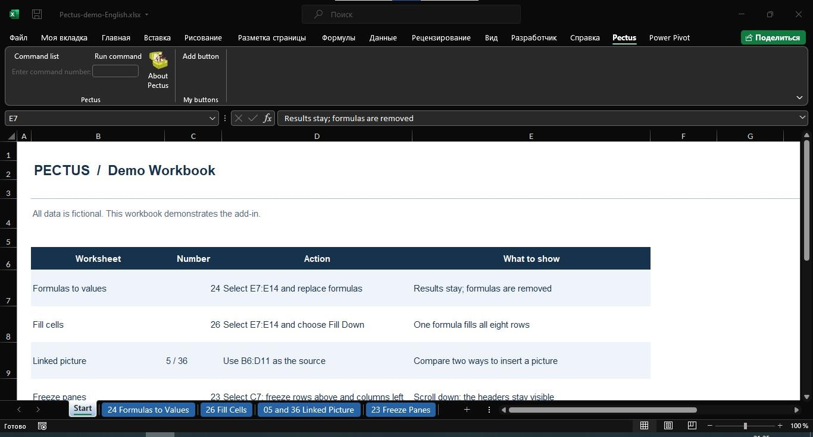
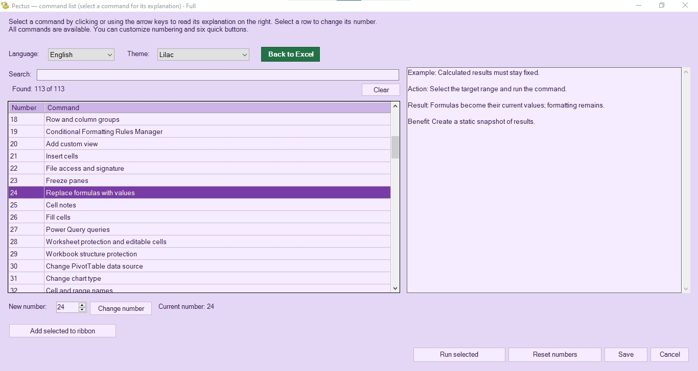
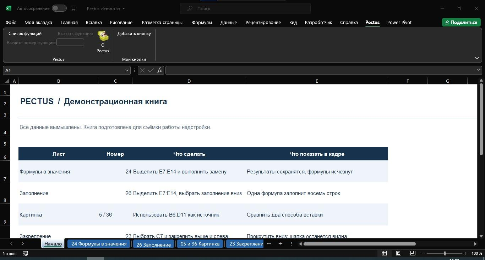

# Pectus — Excel tools by number

Pectus is a local Microsoft Excel add-in built with VB.NET.
Its main idea is simple: remember a tool's catalog number and use it to call that tool quickly.

The add-in runs locally on Windows and does not require a cloud service.

## Catalog and Free edition

The complete catalog contains 113 numbered entries:
75 standalone functions and 38 menus containing 199 actions — 274 actions in total.

**The Free edition provides the first six entries of the standard catalog.**
The screenshots and demonstrations also show tools from the complete catalog;
these are not all available in Free.

Standard catalog numbering follows Russian alphabetical order.
Switching the interface language does not change the numbers.
A catalog number is distinct from a tool's permanent internal ID.

## Download

Download the Free installer from [Releases](https://github.com/Mishin-18/Pectus/releases).

## Demonstrations

English and Russian narrated slideshow demonstrations are available as release assets.
They use actual screenshots and are not live recordings of command execution.

Examples shown:

- No. 24: replace formulas with values while preserving formatting.
- No. 26: fill formulas down.
- No. 5: insert a linked picture that updates when source cells change.
- No. 23: freeze panes.

## Screenshots

### English interface

[Browse English screenshots](screenshots/en)

### Russian interface

[Browse Russian screenshots](screenshots/ru)

## Compatibility

Pectus targets desktop Microsoft Excel on Windows, starting with Excel 2007.
The full catalog has not been verified across every Excel version.
The No. 24 fix was confirmed in Excel 2019 on Windows 11.

## Repository contents

This repository provides product information and screenshots.
The Free installer and narrated demonstrations are distributed through Releases.
Source code is not included.
